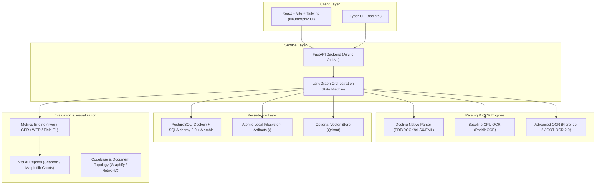

# Master Implementation Plan: Open Doc Intelligence (`docintel`)

> **Master Reference**: [Agent.md](file:///c:/Users/roari/Downloads/AI%20Projects/LLM%20OCR/Agent.md)  
> **Target Framework**: Python 3.10/3.11 | PyTorch | Docling | LangGraph | Florence-2 | GOT-OCR 2.0 | PaddleOCR | PostgreSQL + SQLAlchemy 2.0 + Alembic | FastAPI | React + Vite + Tailwind CSS | Seaborn | Graphify  
> **Execution Scope**: Complete lifecycle from local setup and core engine development to automated testing, evaluation visualization, and secret-safe GitHub release.

---

## 1. System Vision & Architecture Overview

Open Doc Intelligence (`docintel`) is an open-source, local-first document processing, OCR, layout extraction, evaluation, and question-answering platform.

---

## 2. Core Non-Negotiable Operational Principles

1. **Local-First & Offline Default**: No external cloud API calls, zero telemetry, zero hidden proprietary models.
2. **CPU-First Baseline**: System must run completely on CPU before GPU models are loaded.
3. **4 GB VRAM Feasibility**: Heavy models are strictly gated. Primary VLMs are **Microsoft Florence-2** (<2.2 GB VRAM) and **GOT-OCR 2.0** (580M, 4-bit quantized) to prevent CUDA Out-of-Memory crashes.
4. **Production Persistence**: PostgreSQL via Docker Compose with SQLAlchemy 2.0 async ORM and Alembic migrations (with SQLite zero-Docker developer fallback).
5. **Continuous README & Reference Maintenance**: Each and every resource, model, dataset, and dependency must be maintained in `README.md`. Whenever code is modified, the Architecture References table in `README.md` must be updated immediately.
6. **Zero Secret Leakage**: Rigorous `.gitignore` and pre-commit scanning. No API tokens, private documents, or credentials ever committed to Git.
7. **User Gate on Remote Actions**: Never push to GitHub or create public services without explicit user approval.

---

## 3. Phased Execution Roadmap

### Phase 0: Pre-Flight Environment & Hardware Audit
- [ ] Run non-destructive inspection: OS (`systeminfo`), Python (`python --version`), Git (`git --version`), Docker (`docker --version`), GPU (`nvidia-smi`), free disk space, and `uv` package manager availability.
- [ ] Confirm local NVIDIA GPU model, CUDA driver level, and exact VRAM capacity.
- [ ] Initialize living tracking logs: `docs/STATUS.md`, `docs/DECISIONS.md`, and `docs/IMPLEMENTATION_PLAN.md`.
- [ ] **Acceptance Gate**: Verified environment report recorded in `docs/STATUS.md` without modifying user files.

---

### Phase 1: Repository Scaffolding & Secret Hygiene
- [ ] Initialize Git repository (`git init`).
- [ ] Create comprehensive `.gitignore` explicitly excluding:
  - Secrets (`.env`, `*.pem`, `*.key`, credentials)
  - Database volumes & SQLite files (`*.sqlite3`, `data/runtime/db/`, `postgres_data/`)
  - User uploads and raw artifacts (`data/runtime/uploads/`, `data/runtime/documents/`)
  - Model weights caches (`data/models/`, `.cache/`, `hf_cache/`)
  - Virtual environments (`.venv/`, `env/`, `node_modules/`)
  - Python/Node build artifacts (`__pycache__/`, `dist/`, `build/`, `*.egg-info`)
  - Graphify temporary outputs (`graphify-out/`)
- [ ] Create `.env.example` with safe, documented local defaults.
- [ ] Scaffold the canonical repository directory structure matching Section 4 of `Agent.md`:
  - `apps/` (`api/`, `cli/`, `web/`)
  - `src/docintel/` (`config/`, `core/`, `ingestion/`, `extractors/`, `ocr/`, `workflows/`, `storage/`, `retrieval/`, `evaluation/`, `security/`)
  - `configs/` (`app.yaml`, `pipeline.yaml`, `profiles/cpu.yaml`, `profiles/low_vram.yaml`)
  - `deploy/` (`docker/`, `compose/`)
  - `.agents/skills/` (`frontend-development`, `backend-fastapi`, `deployment-docker`, `code-visualization`)
- [ ] Initialize `pyproject.toml` using `uv` with granular dependency groups (`core`, `documents`, `ocr-cpu`, `ocr-vlm`, `workflow`, `retrieval`, `evaluation`, `dev`).
- [ ] **Acceptance Gate**: Clean repository scaffold passes `git status`, `.gitignore` verification, and initial lockfile generation.

---

### Phase 2: Open-Source Resource Canopy & Data Catalog Architecture
- [ ] Create `RESOURCES.md` (Open-Source Resource Canopy) cataloging:
  - All models: Florence-2, GOT-OCR 2.0, PaddleOCR, Docling, Whisper (Hugging Face repos, licenses, parameter counts, VRAM profiles, download links).
  - All libraries & engines: Docling, LangGraph, FastAPI, SQLAlchemy 2.0, Alembic, PostgreSQL, Qdrant, Graphify, NetworkX, jiwer, Seaborn.
  - Evaluation datasets and benchmark schemas.
- [ ] Create `docs/DATA_CATALOG.md` detailing:
  - Storage directory hierarchy (`<data-root>/uploads/`, `<data-root>/documents/<id>/`).
  - Output formats (`document.json`, `document.md`, `metadata.json`, `manifest.json`, `tables/*.csv`).
  - PostgreSQL schema and table definitions with foreign keys and indexes.
- [ ] Create foundational `README.md` containing:
  - Complete project description, local-first privacy guarantee, and zero API cost statement.
  - Architecture diagram (Mermaid).
  - Open-Source Resource Canopy table.
  - Living Architecture & Reference Registry table.
  - One-command quickstart guide (`uv sync`, `npm install`, `python scripts/start.py`).
- [ ] Implement `scripts/doctor.py` checking system health, dependencies, and database readiness.
- [ ] **Acceptance Gate**: `python scripts/doctor.py` executes and outputs an actionable diagnostic report.

---

### Phase 3: Production Database Engine, ORM & Alembic Migrations
- [ ] Configure PostgreSQL service in `docker-compose.yml` (`postgres:16-alpine`, persistent volume, health checks).
- [ ] Implement database engine and session pooling in `src/docintel/storage/database.py` with `create_async_engine` and `async_sessionmaker`.
- [ ] Define declarative SQLAlchemy 2.0 ORM models in `src/docintel/storage/models.py`:
  - `DocumentModel` (ID, SHA-256, MIME, status, config fingerprint, timestamps)
  - `JobModel` (ID, document foreign key, stage, progress, retries, error codes)
  - `PageModel` (document foreign key, index, dimensions, text, engine, confidence, timing)
  - `ElementModel` (page foreign key, element type, bounding box JSONB, reading order)
  - `ArtifactModel` (document foreign key, kind, relative path, SHA-256)
  - `ModelRunModel` (model ID, latency, peak RAM/VRAM, hardware device)
  - `EvaluationScoreModel` (evaluation run foreign key, case ID, CER, WER, field F1, table score)
- [ ] Configure Alembic in `alembic.ini` and `src/docintel/storage/migrations/`:
  - Wire `env.py` to `src/docintel/storage/models.py` metadata and `DOCINTEL_DATABASE_URL`.
  - Generate initial migration: `alembic revision --autogenerate -m "create_initial_schema"`.
- [ ] Implement Repository pattern in `src/docintel/storage/repositories.py`.
- [ ] Add dual dialect support: Primary PostgreSQL with automatic SQLite fallback for zero-Docker testing.
- [ ] **Acceptance Gate**: Automated tests run migrations up and down (`alembic upgrade head` / `downgrade -1`), insert/query documents, and verify transaction rollback on error.

---

### Phase 4: Core Ingestion & Native Extraction Engine
- [ ] Implement file detection and validation in `src/docintel/ingestion/`:
  - `validation.py`: MIME type detection, file size limits, extension check, path traversal prevention.
  - `hashing.py`: SHA-256 computation and deduplication checks.
  - `service.py`: Staging uploads in `<data-root>/uploads/` using generated IDs.
- [ ] Implement canonical Pydantic v2 schemas in `src/docintel/core/schemas.py`:
  - `DocumentRecord`, `PageRecord`, `DocumentElement`, `ArtifactRecord`, `JobRecord`.
- [ ] Implement extractors in `src/docintel/extractors/`:
  - `docling_adapter.py`: Hierarchical parsing of digital PDFs, DOCX, PPTX, XLSX.
  - `text.py`: Plain text, Markdown, HTML, CSV parsing.
  - `email.py`: EML and MSG parsing with safe attachment extraction.
  - `pdf.py`: Detect whether a PDF page has a usable digital text layer or requires OCR.
- [ ] Implement atomic artifact writer in `src/docintel/storage/artifacts.py`:
  - Writes `document.json`, `document.md`, `document.txt`, `metadata.json`, and `manifest.json`.
- [ ] Implement basic CLI command `docintel process <file>` in `apps/cli/`.
- [ ] **Acceptance Gate**: Unit tests verify native ingestion of PDF, DOCX, XLSX, and TXT files with exact SHA-256, schema validation, and zero OCR invocation for digital text.

---

### Phase 5: Baseline CPU OCR & Image Preprocessing
- [ ] Implement `src/docintel/ocr/base.py` defining the `OCRProvider` protocol:
  - `provider_id`, `capabilities()`, `is_available()`, `load()`, `unload()`, `recognize()`, `health()`.
- [ ] Implement image preprocessing pipeline in `src/docintel/ocr/preprocessing.py`:
  - EXIF orientation correction, color mode normalization, DPI scaling, dimension limits.
- [ ] Implement baseline CPU OCR adapter in `src/docintel/ocr/paddle_adapter.py` (or Docling-supported CPU OCR backend).
- [ ] Implement scan detection logic: automatically routes scanned image pages or text-poor PDF pages to the OCR provider.
- [ ] Implement page-scoped error handling: failure on page $N$ does not crash document processing.
- [ ] **Acceptance Gate**: Ingestion of a sample scanned image produces valid text, bounding boxes, and provenance running 100% on CPU without a GPU.

---

### Phase 6: Advanced Vision OCR (VLM) Subsystem
- [ ] Implement Microsoft Florence-2 adapter in `src/docintel/ocr/florence_adapter.py`:
  - Target: `microsoft/Florence-2-base` (~230M) and `Florence-2-large` (~770M).
  - Mode: `<OCR_WITH_REGION>` extracting text tokens alongside exact `[x0, y0, x1, y1]` bounding boxes.
  - Memory: FP16 execution consuming <2.2 GB VRAM on the 4 GB GPU.
  - License: MIT verified.
- [ ] Implement GOT-OCR 2.0 adapter in `src/docintel/ocr/got_ocr_adapter.py`:
  - Target: `sberbank-ai/GOT-OCR2_0` (580M parameters).
  - Mode: Direct Markdown, table, and LaTeX equation formatting.
  - Memory: 4-bit / 8-bit quantization via `bitsandbytes` running under 2.5 GB VRAM.
- [ ] Implement model manager and registry in `src/docintel/ocr/manager.py`:
  - Lazy model initialization (no downloading on app startup).
  - Single GPU model residency lock.
  - Automatic graceful fallback: If VRAM limit or driver error occurs, automatically downgrade the page to CPU baseline OCR.
- [ ] **Acceptance Gate**: Standalone smoke test passes for Florence-2 and GOT-OCR 2.0 on sample document images; bounding boxes and formatted Markdown are verified.

---

### Phase 7: LangGraph Resumable Workflow Engine
- [ ] Implement workflow state schema in `src/docintel/workflows/state.py` (storing paths and IDs, never large binary blobs).
- [ ] Implement workflow DAG nodes in `src/docintel/workflows/nodes.py`:
  1. `validate_input`
  2. `detect_format`
  3. `hash_and_deduplicate`
  4. `select_native_parser`
  5. `extract_native_content`
  6. `assess_ocr_need`
  7. `render_pages_if_needed`
  8. `select_ocr_provider`
  9. `run_baseline_ocr`
  10. `assess_escalation`
  11. `run_advanced_ocr`
  12. `reconcile_outputs`
  13. `normalize_document`
  14. `persist_artifacts`
  15. `update_job_progress`
  16. `finalize_job`
- [ ] Implement conditional routing edges in `src/docintel/workflows/routing.py`.
- [ ] Implement resumable checkpoints and cancellation checks in `src/docintel/workflows/checkpoints.py`.
- [ ] **Acceptance Gate**: End-to-end integration tests prove that interrupted jobs can be reconciled and resumed without data corruption.

---

### Phase 8: Local Evaluation Platform & Seaborn Visualizations
- [ ] Implement evaluation dataset schema and loader in `src/docintel/evaluation/dataset.py`.
- [ ] Implement metric evaluators:
  - `metrics_text.py`: CER and WER using `jiwer` with documented normalization rules.
  - `metrics_fields.py`: Exact-match, precision, recall, and F1 for structured entity fields.
  - `metrics_table.py`: Table structure and cell accuracy scores.
- [ ] Implement publication-quality Seaborn chart generator in `src/docintel/evaluation/charts.py`:
  - CER & WER distribution boxplots comparing Baseline CPU OCR vs. Advanced VLM OCR.
  - Grouped bar plots for field-level extraction F1 scores.
  - Table structure & cell accuracy heatmaps.
  - Throughput vs. CER vs. peak RAM/VRAM scatter plots.
  - Error taxonomy stacked charts.
- [ ] Implement report generator in `src/docintel/evaluation/reports.py` outputting `evaluation_report.md` with embedded high-resolution 300+ DPI chart PNGs.
- [ ] Implement evaluation CLI command: `docintel evaluate --config configs/profiles/evaluation.yaml`.
- [ ] **Acceptance Gate**: Evaluation harness runs against CI smoke dataset, generates verified metrics and Seaborn chart image assets, and writes a complete visual report.

---

### Phase 9: FastAPI Backend Service Layer
- [ ] Implement FastAPI application in `apps/api/`:
  - Localhost binding default (`127.0.0.1:8000`).
  - OpenAPI documentation auto-generated at `/docs`.
  - Non-blocking async background worker execution.
- [ ] Implement versioned endpoints under `/api/v1/`:
  - Health checks: `GET /health/live`, `GET /health/ready`
  - System capabilities: `GET /api/v1/capabilities`
  - Document management: `POST /api/v1/documents` (upload), `GET /api/v1/documents/{id}`, `GET /api/v1/documents/{id}/content`, `GET /api/v1/documents/{id}/artifacts`
  - Job execution: `POST /api/v1/jobs`, `GET /api/v1/jobs/{id}`, `POST /api/v1/jobs/{id}/cancel`
  - Model management: `GET /api/v1/models`, `POST /api/v1/models/{id}/load`, `POST /api/v1/models/{id}/unload`
  - Evaluation trigger & results: `POST /api/v1/evaluations`, `GET /api/v1/evaluations/{id}`
- [ ] Implement standardized error handlers mapping domain errors to safe HTTP status envelopes.
- [ ] **Acceptance Gate**: API integration tests via HTTPX/TestClient verify file upload, job lifecycle, artifact retrieval, and error handling.

---

### Phase 10: Accessible Neumorphic React UI
- [ ] Initialize React + Vite + TypeScript application in `apps/web/`.
- [ ] Configure Tailwind CSS with restrained Neumorphic tokens (soft shadows, light/dark mode palettes, accessible focus rings).
- [ ] Build reusable UI components (Buttons, Cards, Inputs, Progress, Badges, Tabs, Modals).
- [ ] Implement the 10 core screens specified in Section 15.2 of `Agent.md`:
  1. **Dashboard**: Live metrics, job stats, system hardware telemetry (CPU, RAM, GPU, VRAM, Disk).
  2. **Upload**: Drag-and-drop zone, format badges, file size validation, privacy notice.
  3. **Queue**: Real-time stage progress, page-by-page progress bars, cancel and retry controls.
  4. **Document Viewer**: Split-screen view (rendered document vs. extracted text/tables with interactive bounding-box overlays).
  5. **Export**: One-click download of Markdown, JSON, plain text, and table CSVs.
  6. **Search & Citations**: Search interface displaying exact document excerpts and page citations.
  7. **Evaluation Dashboard**: Visual charts embedding the generated Seaborn CER/WER boxplots, field F1 bars, and model comparison metrics.
  8. **Model Settings**: Hardware compatibility status, installed models, download triggers, and VRAM monitors.
  9. **Settings**: Data directory configuration, retention rules, concurrency limits.
  10. **Help & Diagnostics**: Copyable diagnostic report omitting sensitive document text.
- [ ] **Acceptance Gate**: End-to-end browser smoke test (upload document $\rightarrow$ process $\rightarrow$ view extracted text with bounding boxes $\rightarrow$ export Markdown/JSON).

---

### Phase 11: Codebase Topology, Graphify & Architecture Visualization
- [ ] Implement `scripts/visualize_codebase.py`:
  - Parses project AST to generate Mermaid module dependency diagrams and workflow DAG diagrams.
  - Integrates **Graphify** (`graphifyy`): generates interactive 2D/3D `graphify-out/graph.html` and `graphify-out/GRAPH_REPORT.md` detecting architectural hubs and community clusters.
- [ ] Implement document entity knowledge graph mapping in `src/docintel/retrieval/graph.py` using **NetworkX**:
  - Extracts entities and relations from structured document outputs.
  - Enables hybrid vector + graph traversal search.
  - Exports interactive `knowledge_graph.html`.
- [ ] Add `.agents/skills/` playbooks:
  - `frontend-development/SKILL.md`
  - `backend-fastapi/SKILL.md`
  - `deployment-docker/SKILL.md`
  - `code-visualization/SKILL.md`
- [ ] **Acceptance Gate**: Running `python scripts/visualize_codebase.py` produces verified Mermaid architecture diagrams and Graphify visual reports.

---

### Phase 12: Unified Launch Scripts & Docker Profiles
- [ ] Implement unified launcher `scripts/start.py`:
  - Checks Python, Docker, and Node.js environment.
  - Starts PostgreSQL container (if Docker is running).
  - Applies database migrations (`alembic upgrade head`).
  - Launches FastAPI backend and React frontend dev server concurrently.
- [ ] Create multi-stage `Dockerfile`:
  - Non-root user execution, security hardened.
  - Separate stages for build, CPU runtime, and GPU runtime.
- [ ] Configure `docker-compose.yml` with distinct profiles:
  - `core`: PostgreSQL (`postgres:16-alpine`) + persistent volumes + healthcheck.
  - `cpu`: API + UI + PostgreSQL + CPU OCR.
  - `gpu`: GPU-accelerated container with NVIDIA runtime.
  - `vector`: Optional Qdrant service.
  - `demo`: Constrained CPU demo profile with sample files.
- [ ] **Acceptance Gate**: `docker compose config` validates; local launch script starts the full stack seamlessly.

---

### Phase 13: Final README Updates, Secret Audit & Safe GitHub Push
- [ ] **Master README.md Finalization**:
  - Complete project overview, architecture diagram, and feature breakdown.
  - Complete **Open-Source Resource Canopy** table listing every model, dependency, and license.
  - Complete **Architecture References & Component Registry** linking every code file to its underlying documentation and technical specification.
  - Complete **Data & Storage Canopy** explaining storage locations and file formats.
  - Verified step-by-step installation and startup instructions (`python scripts/start.py`).
  - Embedded Seaborn evaluation benchmark results.
- [ ] **Automated Secret & Hygiene Audit**:
  - Run git secret scanner (`detect-secrets` or regex audit) to ensure zero API keys, tokens, `.env` files, or passwords exist in git staging.
  - Verify `.gitignore` is completely honoring all excluded files (no raw uploads, model weights, database files, or cache).
  - Verify all unit and integration tests pass cleanly (`pytest`).
- [ ] **Safe GitHub Push Preparation**:
  - Create release tag and changelog (`v0.1.0`).
  - Generate clean commit history.
  - **AWAIT EXPLICIT USER APPROVAL** before executing any `git remote add` or `git push`.
- [ ] **Acceptance Gate**: Secret scan passes 100% clean; test suite passes 100%; user reviews and signs off on GitHub remote repository push.

---

## 4. Verification & Testing Matrix

| Component | Automated Test Strategy | Verification Command | Success Criteria |
| :--- | :--- | :--- | :--- |
| **System Diagnostics** | Doctor script verification | `python scripts/doctor.py` | All required local tools verified, zero crashes |
| **Database & Migrations** | Alembic upgrade/downgrade test | `uv run pytest tests/unit/test_storage.py` | Schema created, relations verified, rollback clean |
| **Native Ingestion** | Extract PDF/Office/Text | `uv run pytest tests/unit/test_extractors.py` | Valid `document.json`/`md`, zero unnecessary OCR |
| **Baseline OCR** | Scanned image OCR test | `uv run pytest tests/unit/test_ocr_cpu.py` | Text extracted on CPU, bounding boxes present |
| **Advanced OCR (VLM)** | Florence-2 & GOT-OCR test | `uv run pytest tests/unit/test_ocr_vlm.py` | Runs <2.5 GB VRAM, `<OCR_WITH_REGION>` coordinates |
| **LangGraph Workflow** | State DAG & Resumability | `uv run pytest tests/integration/test_workflow.py` | Interrupted jobs resume cleanly, zero data loss |
| **Evaluation & Seaborn** | Golden set & Chart generation | `uv run python scripts/run_evaluation.py` | CER/WER computed, high-res PNG charts generated |
| **Backend API** | FastAPI HTTPX TestClient | `uv run pytest tests/api/` | All endpoints return HTTP 200/201, errors handled |
| **Frontend UI** | Vitest & Build validation | `npm --prefix apps/web test && npm --prefix apps/web run build` | Zero build errors, WCAG contrast compliant |
| **Code Visualization** | Graphify / Mermaid visualizer | `python scripts/visualize_codebase.py` | Visual graphs and architecture reports generated |
| **Secret Audit** | Pre-commit git security scan | `git status` + secret pattern scan | Zero credentials, `.env`, or blobs in git tracking |

---

## 5. Definition of Done for Final Release

The project is considered complete and ready for GitHub push only when:
1. `python scripts/doctor.py` reports healthy system status.
2. `python scripts/start.py` launches the application in one command.
3. Ingestion cleanly extracts native text from digital documents and applies OCR only to scans.
4. Advanced OCR (Florence-2 / GOT-OCR 2.0) executes within the 4 GB VRAM limit.
5. All document outputs preserve source page and bounding box provenance.
6. PostgreSQL schema is fully managed via Alembic migrations.
7. Evaluation harness runs locally and produces beautiful Seaborn charts.
8. `README.md` contains the complete Resource Canopy and updated Reference Registry for all modified code.
9. Security scan confirms zero leaked secrets or private files.
10. The user explicitly approves the final GitHub push.
