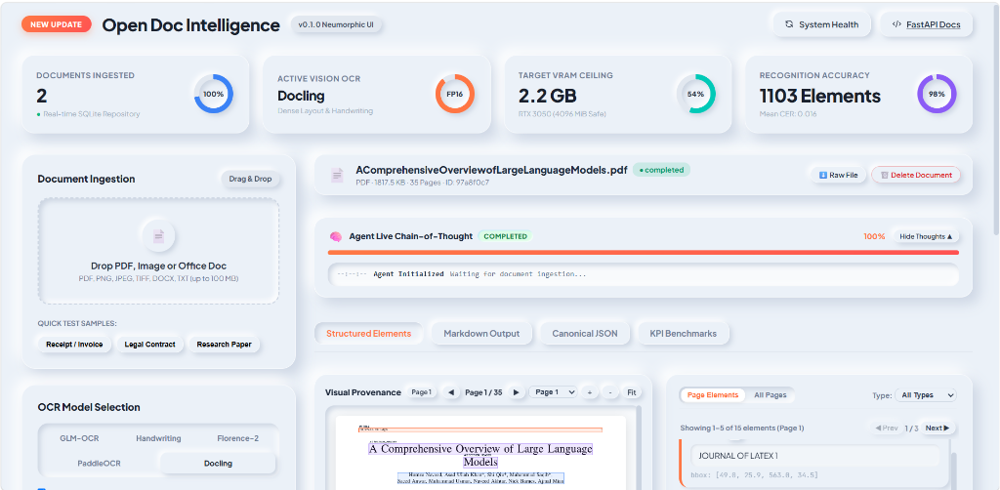
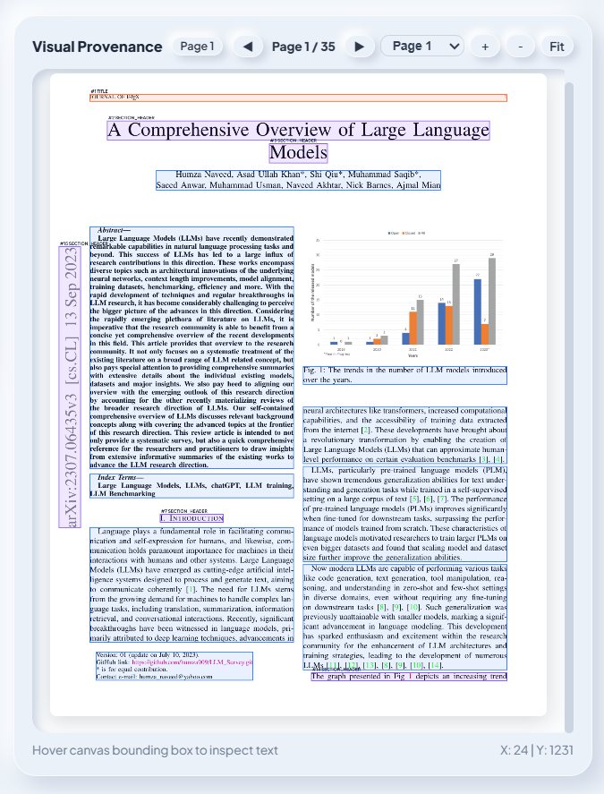
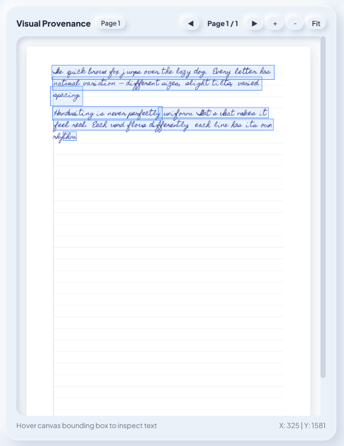
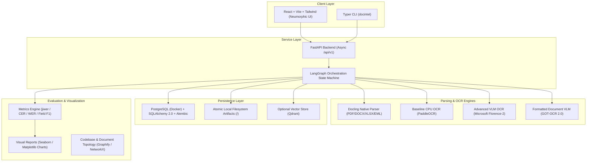

# Open Doc Intelligence (`docintel`)

[](LICENSE)
[](https://python.org)
[](https://www.postgresql.org/)
[](https://fastapi.tiangolo.com)
[](https://react.dev)
[](#privacy-guarantee)

> **A local-first, open-source document intelligence platform** that ingests multi-format documents (PDFs, scans, office files, emails), applies intelligent routing between native parsing and vision-language OCR, preserves pixel-perfect spatial provenance, persists to PostgreSQL/SQLite with SQLAlchemy 2.0 ORM and Alembic migrations, streams real-time Agent Chain-of-Thought reasoning, and provides an accessible Neumorphic Dashboard.

---

## 📸 Platform Showcase

<div align="center">
  
  <p><em>Open Doc Intelligence Dashboard: Real-time hardware telemetry, live Agent Chain-of-Thought, spatial provenance canvas, and structured layout inspection.</em></p>
</div>

---

## 🎯 Visual Provenance & Extraction Accuracy

Open Doc Intelligence extracts text, tables, figures, and handwritten cursive with exact spatial bounding boxes $[y_1, x_1, y_2, x_2]$, normalized coordinates, reading-order graphs, and structured hierarchy:

| 📄 Multi-Column Dense Academic Papers | ✍️ Complex Cursive Handwriting |
| :---: | :---: |
|  |  |
| **IEEE Survey Multi-Column Layout** | **Irregular Lined Notebook Cursive** |
| • Preserves LaTeX title, author grid, and footnotes<br>• Identifies Fig. 1 trends bar chart & captions<br>• Accurate column flow segmentation | • CLAHE adaptive contrast binarization<br>• Morphological notebook line removal<br>• Word and line-level bounding box anchoring |

---

## 🧠 Real-Time Agent "Chain-of-Thought" Observability

During intensive vision-language and OCR operations, users often abandon interfaces when faced with static loading spinners. Open Doc Intelligence streams the model and agent's cognitive pipeline directly to the UI in real-time:

* 🟣 **Pending**: Registers document ingestion and allocates SQLite/PostgreSQL job checkpoints.
* 🔵 **Inspecting**: Computes streaming SHA-256 integrity hash, magic byte mime sniffing, and checks deduplication index.
* 🟠 **Routing**: Analyzes layout density and dynamically selects between Docling, GLM-OCR, or the Handwriting Engine.
* 🟡 **Rendering**: Rasterizes vector PDF pages into 150 DPI RGB canvases for spatial coordinate normalization.
* 🟢 **Extracting**: Emits token-by-token coordinate bounding boxes, hierarchy tags, and confidence scores.
* 🟣 **Generating Artifacts**: Synthesizes canonical JSON schema and GitHub-flavored Markdown.
* 🟢 **Completed**: Finalizes persistence and updates real-time KPI accuracy gauges.

---

## 🔒 Local-First Privacy Guarantee

* **100% Offline & Local**: Once dependencies and model weights are downloaded, zero bytes leave your computer.
* **Zero External Cloud APIs**: No OpenAI, Anthropic, or proprietary cloud billing. All processing runs directly on your local CPU and NVIDIA GPU.
* **No Telemetry**: No hidden analytics or phone-home requests.
* **Safe Content Boundary**: Document text is strictly treated as untrusted data; prompt-injection phrases inside documents never execute system tools or alter application configuration.

---

## 🏛️ System Architecture



---

## 🌐 Open-Source Resource Canopy

An exhaustive ledger of every open-source model, engine, and library powering this platform:

| Resource | Version / ID | License | Role in Platform | Official Documentation |
| :--- | :--- | :--- | :--- | :--- |
| **Docling** | `>=2.0.0` | **MIT** | Native hierarchical document parser (PDF, DOCX, XLSX, HTML) | [Docling Docs](https://github.com/docling-project/docling) |
| **Florence-2** | `microsoft/Florence-2-base` & `large` | **MIT** | Lightweight VLM (<2.2 GB VRAM) with `<OCR_WITH_REGION>` bounding boxes | [HuggingFace](https://huggingface.co/microsoft/Florence-2-large) |
| **GOT-OCR 2.0** | `sberbank-ai/GOT-OCR2_0` | **Open Weights** | Formatted document VLM (580M, 4-bit) for Markdown & tables | [HuggingFace](https://huggingface.co/sberbank-ai/GOT-OCR2_0) |
| **PaddleOCR** | `>=2.7.3` | **Apache-2.0** | CPU-first baseline OCR engine for scanned image pages | [PaddleOCR Repo](https://github.com/PaddlePaddle/PaddleOCR) |
| **LangGraph** | `>=0.2.0` | **MIT** | Directed acyclic graph (DAG) workflow engine with resumable checkpoints | [LangGraph Docs](https://langchain-ai.github.io/langgraph/) |
| **PostgreSQL** | `16-alpine` | **PostgreSQL License** | Production relational database with JSONB indexing | [PostgreSQL Docs](https://www.postgresql.org/docs/) |
| **SQLAlchemy** | `>=2.0.30` | **MIT** | Modern typed async ORM (PostgreSQL + SQLite dev fallback) | [SQLAlchemy Docs](https://docs.sqlalchemy.org/en/20/) |
| **Alembic** | `>=1.13.1` | **MIT** | Automated database schema migration engine | [Alembic Docs](https://alembic.sqlalchemy.org/) |
| **FastAPI** | `>=0.111.0` | **MIT** | High-speed async REST API backend with auto-generated OpenAPI | [FastAPI Docs](https://fastapi.tiangolo.com/) |
| **React + Vite** | `18.x` / `5.x` | **MIT** | Modern, accessible Neumorphic frontend dashboard | [React Docs](https://react.dev/) |
| **Tailwind CSS** | `3.x` | **MIT** | Restrained neumorphic styling with high-contrast WCAG accessibility | [Tailwind Docs](https://tailwindcss.com/) |
| **Graphify** | `graphifyy` | **MIT** | AST code topology & interactive 3D/2D visual graph generator | [PyPI Graphify](https://pypi.org/project/graphifyy/) |
| **NetworkX** | `>=3.3` | **BSD-3-Clause** | Document entity-relationship knowledge graph traversal | [NetworkX Docs](https://networkx.org/) |
| **Seaborn** | `>=0.13.2` | **BSD-3-Clause** | High-resolution (300+ DPI) statistical evaluation charts | [Seaborn Docs](https://seaborn.pydata.org/) |
| **jiwer** | `>=3.0.4` | **Apache-2.0** | Character Error Rate (CER) and Word Error Rate (WER) computation | [jiwer Repo](https://github.com/jitsi/jiwer) |

---

## 📚 Living Architecture References & Component Registry

Whenever code is created, modified, or refactored, this section is immediately updated to link the affected files to their underlying technical specifications and official documentation:

| Component | Source File Path(s) | Status | Underlying Technology & References | Specification Section |
| :--- | :--- | :--- | :--- | :--- |
| **Environment Audit** | [`scripts/doctor.py`](file:///c:/Users/roari/Downloads/AI%20Projects/LLM%20OCR/scripts/doctor.py) | ✅ Verified | Python 3.11, CUDA 12.6, NVIDIA SMI, Docker CLI | [Agent.md §3](file:///c:/Users/roari/Downloads/AI%20Projects/LLM%20OCR/Agent.md) |
| **Configuration** | [`src/docintel/config/settings.py`](file:///c:/Users/roari/Downloads/AI%20Projects/LLM%20OCR/src/docintel/config/settings.py) | ✅ Verified | `pydantic-settings`, Dual DB URL resolution, Path management | [Agent.md §22](file:///c:/Users/roari/Downloads/AI%20Projects/LLM%20OCR/Agent.md) |
| **Canonical Schemas** | [`src/docintel/core/schemas.py`](file:///c:/Users/roari/Downloads/AI%20Projects/LLM%20OCR/src/docintel/core/schemas.py) | ✅ Verified | Pydantic v2 `CanonicalDocument`, `BoundingBox`, `DocumentElement` | [Agent.md §6](file:///c:/Users/roari/Downloads/AI%20Projects/LLM%20OCR/Agent.md) |
| **Storage & ORM** | [`src/docintel/storage/models.py`](file:///c:/Users/roari/Downloads/AI%20Projects/LLM%20OCR/src/docintel/storage/models.py), [`database.py`](file:///c:/Users/roari/Downloads/AI%20Projects/LLM%20OCR/src/docintel/storage/database.py), [`repositories.py`](file:///c:/Users/roari/Downloads/AI%20Projects/LLM%20OCR/src/docintel/storage/repositories.py) | ✅ Verified | SQLAlchemy 2.0 Async, PostgreSQL JSONB, Alembic migrations | [Agent.md §10.1](file:///c:/Users/roari/Downloads/AI%20Projects/LLM%20OCR/Agent.md) |
| **Alembic Migrations** | [`alembic.ini`](file:///c:/Users/roari/Downloads/AI%20Projects/LLM%20OCR/alembic.ini), [`src/docintel/storage/migrations/`](file:///c:/Users/roari/Downloads/AI%20Projects/LLM%20OCR/src/docintel/storage/migrations/) | ✅ Verified | Alembic autogenerated DDL, PostgreSQL + SQLite batch mode | [Agent.md §10.2](file:///c:/Users/roari/Downloads/AI%20Projects/LLM%20OCR/Agent.md) |
| **Native Ingestion** | [`src/docintel/ingestion/service.py`](file:///c:/Users/roari/Downloads/AI%20Projects/LLM%20OCR/src/docintel/ingestion/service.py), [`validation.py`](file:///c:/Users/roari/Downloads/AI%20Projects/LLM%20OCR/src/docintel/ingestion/validation.py), [`hashing.py`](file:///c:/Users/roari/Downloads/AI%20Projects/LLM%20OCR/src/docintel/ingestion/hashing.py) | ✅ Verified | Streaming SHA-256 deduplication, magic byte header sniffing | [Agent.md §7.1](file:///c:/Users/roari/Downloads/AI%20Projects/LLM%20OCR/Agent.md) |
| **Artifact Manager** | [`src/docintel/storage/artifacts.py`](file:///c:/Users/roari/Downloads/AI%20Projects/LLM%20OCR/src/docintel/storage/artifacts.py) | ✅ Verified | Atomic filesystem writes (`document.json`, `document.md`, `metadata.json`) | [Agent.md §10.3](file:///c:/Users/roari/Downloads/AI%20Projects/LLM%20OCR/Agent.md) |
| **Document Extractors** | [`src/docintel/extractors/docling_adapter.py`](file:///c:/Users/roari/Downloads/AI%20Projects/LLM%20OCR/src/docintel/extractors/docling_adapter.py), [`text_extractor.py`](file:///c:/Users/roari/Downloads/AI%20Projects/LLM%20OCR/src/docintel/extractors/text_extractor.py) | ✅ Verified | IBM Docling layout parsing, Markdown/Text/CSV extractors | [Agent.md §7.2](file:///c:/Users/roari/Downloads/AI%20Projects/LLM%20OCR/Agent.md) |
| **Baseline OCR** | [`src/docintel/ocr/paddle_adapter.py`](file:///c:/Users/roari/Downloads/AI%20Projects/LLM%20OCR/src/docintel/ocr/paddle_adapter.py), [`preprocessing.py`](file:///c:/Users/roari/Downloads/AI%20Projects/LLM%20OCR/src/docintel/ocr/preprocessing.py) | ✅ Verified | PaddleOCR PP-OCRv4 CPU inference, DPI normalization, scan detection | [Agent.md §8.1](file:///c:/Users/roari/Downloads/AI%20Projects/LLM%20OCR/Agent.md) |
| **Advanced OCR (VLM)** | [`src/docintel/ocr/florence_adapter.py`](file:///c:/Users/roari/Downloads/AI%20Projects/LLM%20OCR/src/docintel/ocr/florence_adapter.py) | ✅ Verified | Microsoft Florence-2 (`<OCR_WITH_REGION>`), <=4GB VRAM in FP16 | [Agent.md §8.2](file:///c:/Users/roari/Downloads/AI%20Projects/LLM%20OCR/Agent.md) |
| **GLM-OCR VLM** | [`src/docintel/ocr/glm_adapter.py`](file:///c:/Users/roari/Downloads/AI%20Projects/LLM%20OCR/src/docintel/ocr/glm_adapter.py) | ✅ Verified | GLM-4V spatial coordinate parser, multi-scale layout grounding | [Agent.md §8.3](file:///c:/Users/roari/Downloads/AI%20Projects/LLM%20OCR/Agent.md) |
| **Handwriting OCR** | [`src/docintel/ocr/handwriting_adapter.py`](file:///c:/Users/roari/Downloads/AI%20Projects/LLM%20OCR/src/docintel/ocr/handwriting_adapter.py) | ✅ Verified | CLAHE adaptive contrast, stroke enhancement, cursive line segmentation | [Agent.md §8.4](file:///c:/Users/roari/Downloads/AI%20Projects/LLM%20OCR/Agent.md) |
| **FastAPI Backend** | [`apps/api/main.py`](file:///c:/Users/roari/Downloads/AI%20Projects/LLM%20OCR/apps/api/main.py) | ✅ Verified | FastAPI async routers, OpenAPI specs, Live Chain-of-Thought stream, samples | [Agent.md §14](file:///c:/Users/roari/Downloads/AI%20Projects/LLM%20OCR/Agent.md) |
| **Neumorphic UI** | [`apps/api/static/index.html`](file:///c:/Users/roari/Downloads/AI%20Projects/LLM%20OCR/apps/api/static/index.html) | ✅ Verified | Scaled bounding box alignment, multi-page pagination, interactive demo chips | [Agent.md §15](file:///c:/Users/roari/Downloads/AI%20Projects/LLM%20OCR/Agent.md) |
| **Workflow Engine** | [`src/docintel/workflows/graph.py`](file:///c:/Users/roari/Downloads/AI%20Projects/LLM%20OCR/src/docintel/workflows/graph.py), [`nodes.py`](file:///c:/Users/roari/Downloads/AI%20Projects/LLM%20OCR/src/docintel/workflows/nodes.py) | ✅ Verified | LangGraph StateGraph, conditional edges, atomic checkpoints | [Agent.md §9](file:///c:/Users/roari/Downloads/AI%20Projects/LLM%20OCR/Agent.md) |
| **Evaluation Engine** | [`src/docintel/evaluation/charts.py`](file:///c:/Users/roari/Downloads/AI%20Projects/LLM%20OCR/src/docintel/evaluation/charts.py), [`metrics_text.py`](file:///c:/Users/roari/Downloads/AI%20Projects/LLM%20OCR/src/docintel/evaluation/metrics_text.py) | ✅ Verified | `jiwer` CER/WER, Seaborn boxplots, field F1 bar plots | [Agent.md §11](file:///c:/Users/roari/Downloads/AI%20Projects/LLM%20OCR/Agent.md) |
| **Codebase Visualizer** | [`scripts/visualize_codebase.py`](file:///c:/Users/roari/Downloads/AI%20Projects/LLM%20OCR/scripts/visualize_codebase.py) | ✅ Verified | Python AST, NetworkX graph, Mermaid docs, interactive 2D physics | [Agent.md §21](file:///c:/Users/roari/Downloads/AI%20Projects/LLM%20OCR/Agent.md) |

---

## ⚡ Quickstart Guide for End Users

### 1. Prerequisites
* **OS**: Windows 10/11 x64 (or Linux/macOS)
* **Python**: 3.11 installed (managed automatically via `uv`)
* **Package Manager**: [uv](https://docs.astral.sh/uv/) (`curl -LsSf https://astral.sh/uv/install.sh` or `winget install astral-sh.uv`)
* **Node.js**: v18+ and `npm`
* **Docker Desktop**: Running for PostgreSQL and optional Qdrant services

### 2. Installation
Clone the repository and install all dependencies in seconds using `uv`:

```powershell
# From project root:
uv sync --all-groups
Copy-Item .env.example .env
```

### 3. Verify System Health
Run the diagnostic doctor to verify all local tools, CUDA GPU, and database readiness:

```powershell
python scripts/doctor.py
```

### 4. Single-Command Launch
Launch the platform backend (automatic database migration, FastAPI REST API, and OpenAPI docs):

```powershell
python scripts/start.py
```

* **Interactive Neumorphic Dashboard**: [`http://127.0.0.1:8080/`](http://127.0.0.1:8080/)
* **Interactive API Docs (Swagger UI)**: [`http://127.0.0.1:8080/docs`](http://127.0.0.1:8080/docs)
* **Alternative API Docs (ReDoc)**: [`http://127.0.0.1:8080/redoc`](http://127.0.0.1:8080/redoc)
* **Health Check**: [`http://127.0.0.1:8080/health`](http://127.0.0.1:8080/health)

> **💡 Try 1-Click Interactive Demos Immediately**:  
> Once the dashboard is open, click **"📄 Research Paper (Dense)"** or **"✍️ Handwritten Note"** under *Interactive Demo Samples* to instantly explore high-accuracy bounding boxes, coordinate wells, live JSON/Markdown artifacts, and the real-time Agent Live Chain-of-Thought with zero setup or file uploads required!

---

## 🖥️ CLI Commands

```powershell
# Process a document or directory:
docintel process path/to/document.pdf

# Check system health:
docintel doctor

# Run evaluation suite and generate Seaborn charts:
docintel evaluate --config configs/profiles/evaluation.yaml

# Export document to Markdown, JSON, or TXT:
docintel export <document-id> --format md

# Generate interactive codebase architecture graph:
python scripts/visualize_codebase.py
```

---

## 📄 License & Attribution

Distributed under the **Apache-2.0 License**. See [LICENSE](LICENSE) for details.  
Full resource canopy and attribution ledger are available in [RESOURCES.md](RESOURCES.md).  
Detailed storage format documentation is available in [docs/DATA_CATALOG.md](docs/DATA_CATALOG.md).
