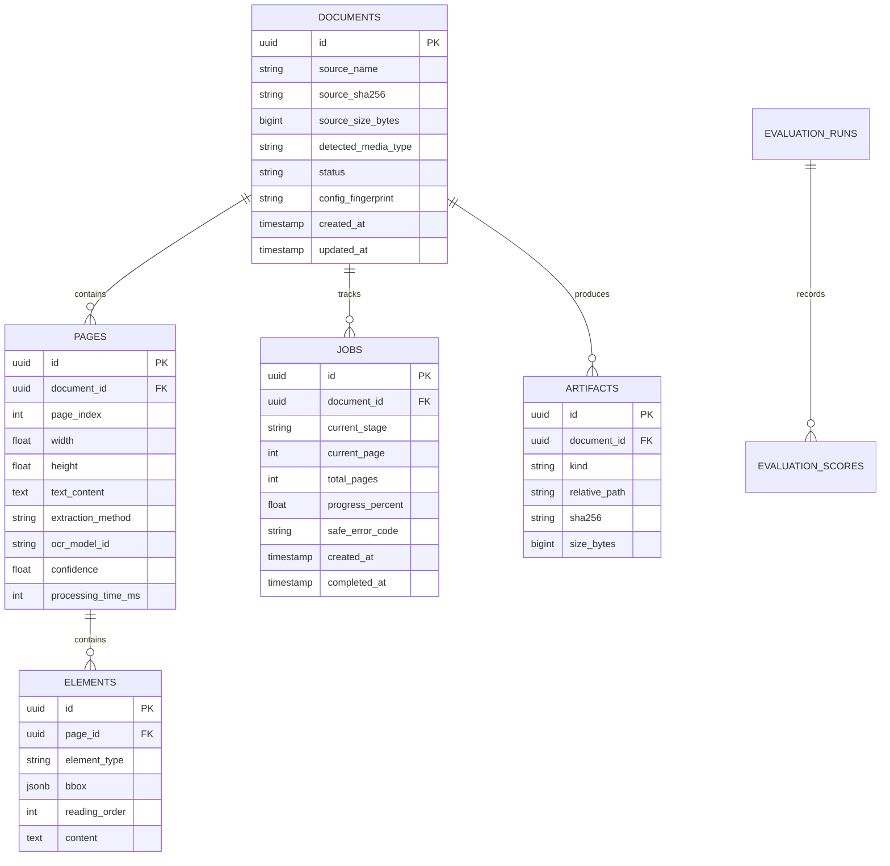

# Data Storage & Schema Catalog: Open Doc Intelligence (`docintel`)

> **Master Reference**: [Agent.md](file:///c:/Users/roari/Downloads/AI%20Projects/LLM%20OCR/Agent.md) | [Plan.md](file:///c:/Users/roari/Downloads/AI%20Projects/LLM%20OCR/Plan.md)  
> **Purpose**: Transparent inventory of where all uploaded documents, processed artifacts, database schemas, and metrics are stored and structured.

---

## 1. Storage Layout Hierarchy

All runtime data is strictly isolated outside the source code tree under `<data-root>/` (default: `./data/runtime/`):

```text
data/runtime/
├── uploads/                        # Raw uploaded files staged with sanitized UUIDs
│   └── 550e8400-e29b-41d4-a716...  # Staged bytes before validation & parsing
│
├── documents/<document-id>/        # Processed document output canopy
│   ├── source/                     # Immutable preserved copy of source file
│   │   └── original_contract.pdf
│   ├── normalized/                 # Canonical normalized representations
│   │   ├── document.json           # Canonical structured Pydantic payload
│   │   ├── document.md             # Clean normalized Markdown
│   │   └── document.txt            # Plain extracted text stream
│   ├── pages/                      # Page-level artifacts
│   │   ├── page_0001.json          # Per-page text, confidence, timing, method
│   │   └── page_0001_rendered.png  # Optional rendered page image for visual review
│   ├── tables/                     # Extracted tabular structures
│   │   ├── table_0001.csv          # High-fidelity CSV export of extracted table
│   │   └── table_0001.json         # Cell-level structure with row/col spans
│   ├── assets/                     # Embedded figures & images
│   │   └── figure_0001.png
│   ├── metadata.json               # Hashes, config fingerprint, runtime versions
│   ├── manifest.json               # Cryptographic inventory of all generated outputs
│   └── errors.json                 # Sanitized page-level error details (if any)
│
├── temp/                           # Temporary working buffers (auto-cleaned)
└── logs/                           # Structured JSON application event logs
```

---

## 2. Production PostgreSQL Database Schema

Managed via SQLAlchemy 2.0 ORM (`src/docintel/storage/models.py`) and versioned with Alembic migrations (`src/docintel/storage/migrations/`).

### Tables & Relationships



---

## 3. How to Query & Inspect Stored Data

Users can inspect all stored database records using standard SQL client tools or the built-in CLI:

```powershell
# Using the CLI:
docintel jobs list
docintel document status <document-id>
docintel export <document-id> --format md

# Direct PostgreSQL query (via Docker):
docker exec -it docintel-postgres psql -U docintel -d docintel -c "SELECT id, source_name, status, created_at FROM documents;"
```
