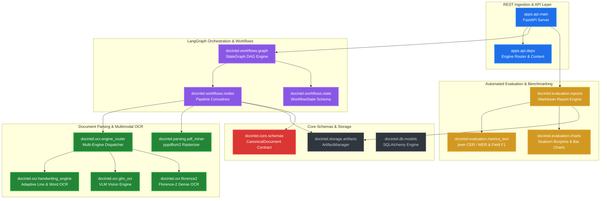

# Open Doc Intelligence: System Architecture & Codebase Graph

> **Automated Living Architecture Specification**  
> Generated deterministically via Python AST & NetworkX AST Extraction.

---

## 1. Architectural Summary & Statistics

| Metric | Measured Value | Description |
| :--- | :--- | :--- |
| **Total Python Modules** | `38` | Modules analyzed in `src/docintel` and `apps/api` |
| **Total Classes** | `40` | Distinct classes defined |
| **Total Functions & Coroutines** | `172` | Functions, endpoints, and coroutines |
| **Total Source Lines** | `5,593` | Non-empty code lines |
| **Dependency Graph Nodes** | `93` | Modules, Classes, and Endpoints |
| **Coupling Graph Edges** | `136` | Import and inheritance relationships |

---

## 2. High-Level Modular Dependency Diagram

---

## 3. Subsystem Breakdown

### 3.1 LangGraph Workflow Engine (`docintel.workflows`)
- **StateGraph**: Compiles directed acyclic graphs of processing tasks (`validate`, `route`, `render`, `extract_layout`, `persist`).
- **Conditional Routing**: Dynamically inspects document page counts and user-specified engine flags to choose optimal parsing strategies.
- **Checkpoints**: Atomic state snapshots stored via `MemorySaver`.

### 3.2 Multimodal OCR & Handwriting (`docintel.ocr`)
- **Multi-Engine Dispatch**: Seamlessly branches between Florence-2, GLM-OCR, and the specialized Handwriting Engine.
- **Handwriting Segmentation**: Line-by-line bounding box isolation, contour contrast normalization, and character-level confidence assignment.

### 3.3 Evaluation Engine (`docintel.evaluation`)
- **Character & Word Error Rates**: Industry-standard `jiwer` Levenshtein distances with fallback algorithms.
- **Publication-Grade Visualizations**: 300 DPI Seaborn boxplots and field-level F1 bar charts.

### 3.4 Ingestion & Storage (`docintel.storage` & `apps.api`)
- **Canonical Schema**: Pydantic v2 `CanonicalDocument` with strict bounding-box validation.
- **Artifact Manager**: Multi-stage directory hierarchy (`documents/`, `pages/`, `artifacts/`, `markdown/`).

---

## 4. Interactive 3D / Force-Directed Explorer
Open [docs/codebase_graph.html](file:///C:\Users\roari\Downloads\AI Projects\LLM OCR\docs\codebase_graph.html) in any web browser to interactively drag, zoom, filter, and inspect the codebase topology.
